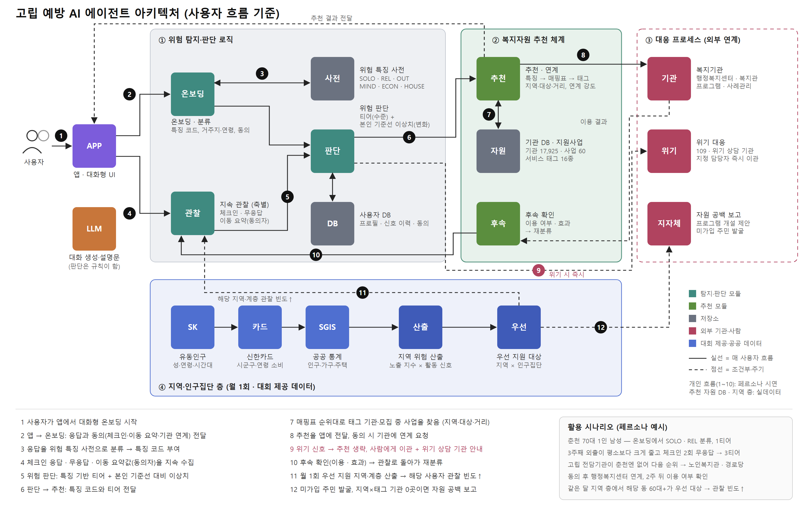

# 고립 예방 에이전트 서비스 플로우 v1.1 — 2026-10-20

> 팀 논의용 초안이다. v1.0(10/15)에 기관 수집(#18) 결과를 반영했다. 판정 기준·문항 같은 세부는 #17 위험 특징 사전 확정 후 정한다.

**v1.1 변경 요약**

- 기관 태그를 위험 특징과 같은 코드로 쓰지 않고, 서비스 기준 태그 16종 + 매핑표로 잇는 구조로 바꿨다 (1절).
- 4단계 추천·연계의 절차와 쓰는 파일을 구체화했다. 추천 대상에 지원사업을 더했다 (2·3절).
- 연계 강도를 태그별 1\~4로 정했다 (2절).
- 온보딩에서 거주 시군구와 연령대를 받는다 (2절).
- 위기 분기에 위기 상담 기관 안내를, 지역 층에 자원 공백 계산 방법과 실제 공백 사례를 더했다 (2절).
- 시연 범위와 한계, 다음에 정할 것을 갱신했다 (6·7절).

## 1. 전제

- 대회 요구(주제설명자료 1008): 위험 신호 탐지 → 위험 수준 판단 → 원인 분석 → 대응 방안·복지자원 추천 → **우선 지원 대상 지역·계층 도출**. 단위는 "지역 및 인구집단"이다.
- 팀 결정(10/15 회의): 서비스 대상은 개인이다. 고립 대상은 [위험 특징 사전](https://app.notion.com/p/3fa1fad9262e8001bba3d049587667f8)(SOLO, REL, OUT, MIND, ECON, HOUSE 등)으로 분류한다.
- **기관은 서비스 태그 16종으로 분류하고, 위험 특징과 태그는 매핑표로 잇는다.** 위험 특징(사람의 상태)과 기관 태그(기관이 제공하는 서비스)를 같은 코드로 쓰지 않는다. 그래서 #17 범주가 바뀌어도 기관 태그는 그대로 두고 매핑표만 고친다. 태그 정의와 매핑은 [`resource-tags.md`](resource-tags.md)에 있다.
- 위험 지표와 위험 특징 사전 설계는 다른 팀원이 맡는다. 이 문서는 그 결과를 받아 쓰는 서비스 흐름만 다룬다.

## 2. 서비스 플로우



원본: [`architecture.html`](architecture.html) (SVG). 수정 후 Chrome headless 스크린샷으로 PNG를 다시 만든다.

```
0. 온보딩
   - 질문으로 위험 특징 정보 수집
   - 거주 시군구와 연령대 수집 (추천 기관을 거르는 데 씀)
   - 동의 받기 (체크인 알림, 이동 요약값 수집, 기관 연계 시 정보 제공)
        ↓
1. 분류
   - 위험 특징 사전에 따라 특징 코드 부여 (SOLO, REL, OUT ...)
        ↓
2. 지속 관찰  ◀──────────────────────────────┐
   - 고립 축별 추적: 체크인 / 무응답 / 이동(동의자) │
        ↓                                      │
3. 위험 탐지                                    │
   - 수준: 위험 특징 개수·점수로 티어 결정          │
   - 변화: 본인 평소 상태 대비 이상치              │
   ├─ 위기 → 사람에게 즉시 이관                    │
   │        + 위기 상담 기관(CRISIS_LINE) 안내      │
   ├─ 변화 없음 → 2로 ─────────────────────────┤
        ↓                                      │
4. 추천·연계                                    │
   - 특징 → 매핑표에서 추천 태그와 순서 확인        │
   - 태그 기관을 시군구·대상 연령·운영 상태로 거름   │
   - 가까운 순 최대 3곳 + 모집 중인 지원사업        │
   - 해당 태그 기관이 없으면 다음 순위 태그로       │
   - 티어가 높을수록 연계 강도가 높은 태그          │
     (1 스스로 이용 → 2 상담 → 3 사례관리)          │
        ↓                                      │
5. 후속 확인                                    │
   - 이용했는지, 도움이 됐는지 기관·사업 ID로 기록   │
   - 확인 결과로 1에서 재분류 ───────────────────┘

[지역·인구집단 층 — 월 1회]
제공 데이터(SK·카드) + 지역 노출 지수
   → 우선 지원 지역·계층 도출
   → ① 해당 지역·계층 사용자의 관찰 빈도 높이기 (2에 반영)
     ② 아직 가입하지 않은 주민 대상 발굴·가입 유도
     ③ 지역 × 태그 기관 수가 0이면 '자원 공백'으로 보고
```

**4단계 추천·연계 상세**

1. 사용자의 위험 특징을 `feature_tag_mapping.csv`에 넣어 추천할 태그와 순서를 정한다.
2. `institutions.csv`에서 그 태그를 가진 기관을 사용자 시군구 → 대상 연령(`TARGET_AGE`) 일치 순으로 거른다. 위수탁 종료일(`VALID_UNTIL`)이 지난 기관은 "운영 여부 확인 필요"로 표시한다.
3. 좌표가 있으면 가까운 순으로 정렬해 최대 3곳을 고른다.
4. `support_programs.csv`에서 같은 태그·지역의 사업 중 모집 기간(`APPLY_END`)이 남은 것을 함께 안내한다.
5. 해당 태그 기관이 그 지역에 없으면 다음 순위 태그로 넘어간다. 예: 고립 전담기관(`ISOLATION_CARE`)은 서울에만 있어서 춘천에서는 다음 순위인 사회참여(`SOCIAL_PART`) 기관을 추천한다.

**연계 강도**

태그마다 연계 강도를 정했다. 티어가 높을수록 강도가 높은 태그를 먼저 쓴다. 티어와 강도를 어떻게 대응시킬지는 7절에서 정한다.

| 강도 | 성격 | 태그 |
|---|---|---|
| 1 | 정보·참여형 (스스로 이용) | `SOCIAL_PART`, `LEARNING`, `PHYSICAL`, `MEAL` |
| 2 | 상담·관계형성형 | `MENTAL_CARE`, `ADDICTION`, `DEMENTIA`, `HEALTH_MGMT`, `JOB_INCOME`, `HOUSING`, `DISABILITY`, `FAMILY` |
| 3 | 사례관리형 (기관이 개입) | `ISOLATION_CARE`, `CARE_CHECK`, `CASE_MGMT` |
| 4 | 위기 개입 | `CRISIS_LINE` |

**자원 공백 (지역 층 ③)**

지역 × 태그별 기관 수로 계산한다. 현재 수집 결과에서 확인된 공백은 다음과 같다.

- 고립 전담기관(`ISOLATION_CARE`)은 서울에만 있다 (103곳).
- 강남구 안에 위기 상담 기관(`CRISIS_LINE`)이 없다. 서울시 단위 기관 4곳으로 연결해야 한다.
- 인천은 공공체육시설(`PHYSICAL`), 경기·춘천은 가족센터(`FAMILY`) 목록이 없다. 실제 기관이 없는 것인지 공개 자료가 없는 것인지는 구분해야 한다.

## 3. 단계별 역할

| 단계 | 핵심 질문 | 쓰는 데이터 |
|---|---|---|
| 0 온보딩 | 이 사람은 처음에 어떤 상태이고 어디에 사는가 | 온보딩 응답 (위험 특징, 거주 시군구, 연령대) |
| 1 분류 | 어떤 위험 특징을 가졌나 | 위험 특징 사전 (#17) |
| 2 관찰 | 상태가 바뀌고 있나 | 체크인, 무응답, 이동·체류 |
| 3 탐지 | 지금 개입해야 하나, 얼마나 강하게 | 티어 + 이상치 |
| 4 연계 | 무엇을 연결하나 | `feature_tag_mapping.csv`, `institutions.csv`, `support_programs.csv` |
| 5 후속 | 효과가 있었나 | 이용 여부(기관·사업 ID), 다음 체크인 |
| 지역 층 | 어디의 누구를 먼저 챙기나 | SK·카드·SGIS (대회 제공 데이터 필수 사용), 지역 × 태그 기관 수 |

## 4. 지속 관찰 신호

온보딩은 한 시점의 상태라서, 이후 변화를 아래 신호로 따라간다.

| 신호 | 수집 방법 | 비고 |
|---|---|---|
| 체크인 응답 | 대화로 1\~2문항씩 정기적으로 묻기 (외로움·우울 척도) | 위험 단계가 높을수록 자주 묻는다 (월 1회\~매일) |
| 무응답·응답 지연 | 체크인 기록 | 답이 없다는 것 자체가 위험 신호다 |
| 이동·체류 | 휴대폰 안에서 계산한 요약값만 전송 (집 체류시간, 외출 횟수, 저녁·주말 외출) | 동의한 사람만 쓴다. 근거는 Doryab 2019 |
| 지역 신호 | 지역 고립 노출 지수 × 고령층 유동 감소 신호(H4) | 대회 제공 데이터(SK)를 실제로 쓰는 부분 |

원칙:

- **본인 평소 상태 대비 변화로 판단한다.** 절대값(예: 하루 20시간 집에 있음)은 재택·교대근무자에게 정상일 수 있다.
- **지역 신호는 개인 등급을 올리지 않는다.** 해당 지역·계층 사용자의 관찰 빈도를 높이는 데만 쓴다 (생태학적 오류 방지).
- **판단은 규칙이, LLM은 대화와 설명을 맡는다.** 위기 판단은 항상 사람에게 넘긴다.

### 4-1. 추가 기능: 고립 축 기반 추적 (제안)

고립 지표가 확정되면 그 지표를 이루는 축(예: 독거, 관계, 외출, 정신건강, 경제, 주거)이 정해진다. 지속 관찰을 범용 체크인이 아니라 **이 축별로 추적**하도록 설계한다. 그러면 온보딩 → 관찰 → 판단 → 추천이 같은 축 어휘로 이어져, "어느 축이 나빠졌고 그래서 어떤 자원을 연결했는지"를 한 줄로 설명할 수 있다.

**축 레지스트리.** 축이 아직 확정되지 않았으므로, 관찰 기능은 축 목록을 코드에 박지 않고 설정표로 받는다. 지표가 바뀌면 표만 고친다.

| 열 | 내용 | 예시 (OUT 축) |
|---|---|---|
| 축 코드 | 위험 특징 사전과 같은 코드 | `OUT` |
| 지표 축 대응 | 지역 지표의 어느 축과 대응하는지 | 활동 신호(H4) |
| 성격 | 정적(잘 안 변함) / 동적(자주 변함) | 동적 |
| 개인 측정 방법 | 체크인 문항, 이동 요약, 사건 질문 | 이동 요약 + "지난주 외출 일수" 문항 |
| 측정 주기 | 정적은 분기·사건 발생 시, 동적은 위험 단계에 따라 | 주 1회 \~ 매일 |
| 변화 기준 | 본인 기준선 대비 악화 조건 | 기준선 대비 크게 감소가 2주 지속 |
| 민감도·동의 | 별도 동의가 필요한지 | 이동 요약은 별도 동의 |
| 연결 자원 태그 | 악화 시 매칭할 기관 태그 (`feature_tag_mapping.csv` 순서) | `ISOLATION_CARE` → `SOCIAL_PART` → `PHYSICAL` → `LEARNING` |

**설계 조건:**

1. **정적 축과 동적 축을 나눈다.** 독거·주거처럼 잘 바뀌지 않는 축은 매번 묻지 않고, 분기 재확인이나 "이사했어요", "가족이 떠났어요" 같은 사건이 대화에서 나올 때만 갱신한다. 지속 추적은 관계·외출·정신건강 같은 동적 축에 집중한다.
2. **질문 예산을 둔다.** 체크인 1회에 1\~2문항만 묻고, 축을 돌아가며 묻는다. 최근 악화된 축과 온보딩에서 위험으로 분류된 축을 먼저 묻는다. 문항이 늘면 응답률이 떨어지고, 무응답 신호까지 오염된다.
3. **지역 축과 개인 측정은 같은 것이 아니다.** 지역 지표의 축(예: 집계구 1인가구 비율)은 지역 단위 값이다. 개인 측정(예: 본인의 동거 여부)과 이름만 공유한다. 축 대응표는 어휘를 맞추는 용도이고, 지역 값을 개인 점수로 쓰지 않는다.
4. **민감 축은 동의를 따로 받는다.** 정신건강·경제 축은 응답을 거부해도 서비스가 계속되어야 하고, 거부는 위험 신호로 세지 않는다.

**축이 확정되기 전 진행 방법:** 위험 특징 사전 예시 코드(SOLO, REL, OUT, MIND, ECON, HOUSE)로 레지스트리 초안을 채워 페르소나 시연을 먼저 돌린다. 지표 확정 후 축 코드와 대응 열만 교체한다.

## 5. 대회 요구와의 대응

| 대회 필수 흐름 | 플로우 위치 |
|---|---|
| 위험 신호 탐지 | 2 관찰, 지역 층 |
| 위험 수준 판단 | 3 탐지 |
| 위험 원인 분석 | 1 분류 (어떤 특징 때문인지) |
| 대응 방안·복지자원 추천 | 4 추천·연계 (기관 17,925곳, 지원사업 60건) |
| 우선 지원 대상 지역·계층 도출 | 지역 층 |
| 데이터 지속 활용성 (평가 10점) | 5 후속 확인 결과가 기관·사업 ID에 쌓여 특징별 자원 효과를 평가. 기관 목록은 수집·정제 코드로 다시 만들 수 있음 |

## 6. 시연과 한계

- 개인 단위 흐름(0\~5)의 사용자 데이터는 실데이터가 없어 **페르소나 합성 데이터**로 시연한다. 생성 방식 설명자료를 함께 제출한다 (대회 규칙).
- **실데이터로 도는 부분:** 지역 층(대회 제공 데이터)과 4단계 추천에 쓰는 기관·지원사업 DB(공공데이터, [`resource-tags.md`](resource-tags.md)).
- 이동·체류 수집은 동의, 단말 권한, 배터리 문제가 있어 선택 기능으로 둔다. 없어도 체크인만으로 흐름이 돌아가야 한다.
- **추천 자원 DB의 한계:**
  - 좌표가 있는 기관은 73.6%다. 사회복지관·행정복지센터 등은 원본에 좌표가 없어, 거리순 추천을 하려면 지오코딩(주소 → 좌표)이 필요하다.
  - 태그는 기관 유형 단위 규칙으로 붙였다. 개별 기관의 실제 서비스와 다를 수 있어, 시연에 쓰는 기관은 홈페이지로 다시 확인한다.
  - 일부 원본은 기준일이 오래됐다 (노인맞춤돌봄 수행기관 2024-04 기준).

## 7. 다음에 정할 것

**해결됨 (v1.1)**

- 기관 태그 어휘 16종과 태그별 연계 강도 (#18)

**남은 것**

- 위험 특징 사전 확정본의 코드 이름 (#17) → 확정 후 `feature_tag_mapping.csv` 코드 맞추기
- 분석 팀이 지역 층에 넘길 결과 형식 (입력 계약)
- 티어 수와, 티어별로 쓸 연계 강도
- 고립 지표 축 확정 후 축 레지스트리 교체 (4-1)
- 거리순 추천을 위한 지오코딩 여부
- 서울시고립예방센터 누리집 수집 자료를 대회 규정상 쓸 수 있는지 확인
