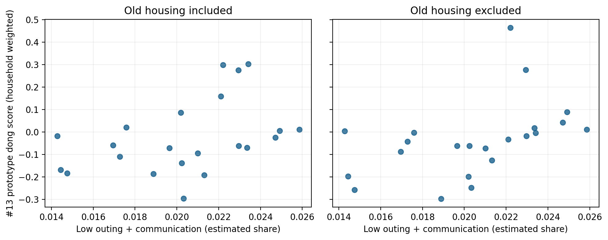

# 강남 22개 동 외부 연관 검증 보완 (#15)

> 2026-10-23 · [사전 설계](../docs/plans/261023_issue15_gangnam_external_validation_design.md) · [#25 공통 검증](261022_EDA_telecom_validation_v3.md)

## 결론

#25가 만든 v3.3 지수와 서울 통신 관심집단 비율의 공통 검증을 그대로 인정한다. 여기서는 이전 #13 프로토타입의 **노후주택 포함·제외** 두 버전을 같은 집계구와 같은 일반가구 가중치로 동에 올려 비교했다. 노후주택을 제외하면 22개 동의 주 관심집단 비율과 순위 상관이 `0.421 → 0.606`으로 높아지고, 일부 동 순위도 크게 움직인다. 그러나 두 상관의 차이에 대한 동 단위 부트스트랩 95% 구간이 0을 포함한다. 따라서 노후주택 제외가 더 낫다고 확정하지 않는다.

이 값은 **동별 지표 간 연관**이다. 통신 관심집단은 추정 집단이며, 개인의 고립 여부나 개별 집계구의 실제 고립을 검증한 값이 아니다. #13과 v3.3은 구성 차원·척도가 달라 절대 점수를 서로 비교하지 않는다.

## 입력과 계산

| 입력 | 행·버전 확인 | 사용 |
|---|---:|---|
| #13 노후주택 포함/제외 CSV | 각 1,649개 집계구, SHA-256 `ff96f9fa4d42a02c` / `739a950360b87448` | 같은 `TOT_OA_CD`의 두 점수·등급 |
| SGIS 2024 마스터 | 1,698개 집계구 × 6개월 | 전체 코드, 제외 조건, 일반가구 수 |
| #25 `gangnam22_v3_validation.csv` | 22개 동, `ebcf88579b98ee16` | `ratio_pop_all`, `ratio_pop_old65`, v3.3 `score_w` 재사용 |
| v3.3 동 지수 | 47개 동, `23f77441bc0fd4a9` | #25 버전 대조 |
| 서울 10개 관심집단수·29개 통신정보 | 각 2025년 7~12월 6개 파일 | 보조 신호와 60세 이상 비율 |

동별 프로토타입 점수는 `Σ(집계구 점수 × 일반가구 수) / Σ(평가된 집계구 일반가구 수)`다. 두 버전의 평가 집계구 1,649개와 가중치는 동일하다. 강남은 그중 1,055개다. 원본 5등급은 **전체 집계구 기준 등급**이므로 동 등급으로 해석하지 않고, 5등급 집계구 수와 가구 비중만 별도로 보존했다. 주 관심집단 비율은 #25처럼 **같은 동·성·연령·월의 관심집단 추정 인원 / 해당 집단 인구**이며 `÷ 1인가구 수`가 아니다. 보조 비율도 월별 분자 합 ÷ 분모 합을 구한 뒤 6개월 평균했다.

## 노후주택 포함·제외 결과

| 관심집단 대상 | 포함 ρ | 제외 ρ | 차이(포함−제외) | 차이의 95% 부트스트랩 구간 | leave-one-out 차이 범위 |
|---|---:|---:|---:|---:|---:|
| 전체, #25 `ratio_pop_all` | 0.421 | 0.606 | -0.185 | [-0.432, 0.120] | [-0.244, -0.138] |
| 65세 이상, #25 `ratio_pop_old65` | 0.359 | 0.619 | -0.261 | [-0.572, 0.062] | [-0.304, -0.175] |

22개 동 Spearman 상관이다. 차이는 같은 동을 함께 복원추출한 2,000회 백분위 구간(시드 42)으로 계산했다. 표본이 22개라 점 추정만으로 버전의 우열을 정할 수 없다. #25의 v3.3 `score_w`와 주 비율의 ρ=0.639는 **이미 보고된 공통 검증 결과의 재사용**이며 이 보고서의 새 검증 건수에 더하지 않는다.

아래 순위는 각 프로토타입의 동 점수 내림차순이며 `변화 = 제외 순위 − 포함 순위`다. 양수면 노후주택 제외 후 순위가 내려갔다. `점수 산출 집계구`는 해당 동에서 #13 프로토타입 점수가 실제로 계산된 집계구 수/전체 집계구 수다. 통신자료와 맞는지 검증했다는 뜻이 아니다. 22개 동 전체의 개별 값은 로컬 `data/processed/validation_gangnam_dong.csv`에 있다.

| 동 | 점수 산출 집계구 | 포함 순위 | 제외 순위 | 변화 | 주 비율 |
|---|---:|---:|---:|---:|---:|
| 압구정동 | 50/55 | 1 | 9 | +8 | 2.3% |
| 수서동 | 27/28 | 2 | 1 | -1 | 2.2% |
| 일원1동 | 29/29 | 3 | 2 | -1 | 2.3% |
| 신사동 | 29/30 | 4 | 11 | +7 | 2.2% |
| 대치2동 | 67/68 | 5 | 19 | +14 | 2.0% |
| 개포3동 | 30/32 | 6 | 8 | +2 | 1.8% |
| 삼성1동 | 24/24 | 7 | 6 | -1 | 2.6% |
| 논현1동 | 42/42 | 8 | 3 | -5 | 2.5% |
| 개포4동 | 47/48 | 9 | 7 | -2 | 1.4% |
| 역삼1동 | 67/68 | 10 | 4 | -6 | 2.5% |
| 도곡1동 | 37/37 | 11 | 16 | +5 | 1.7% |
| 논현2동 | 42/42 | 12 | 10 | -2 | 2.3% |
| 대치4동 | 36/36 | 13 | 5 | -8 | 2.3% |
| 도곡2동 | 51/58 | 14 | 14 | 0 | 2.0% |
| 청담동 | 49/49 | 15 | 15 | 0 | 2.1% |
| 세곡동 | 78/86 | 16 | 12 | -4 | 1.7% |
| 삼성2동 | 62/62 | 17 | 13 | -4 | 2.0% |
| 개포1동 | 49/52 | 18 | 18 | 0 | 1.4% |
| 개포2동 | 79/84 | 19 | 21 | +2 | 1.5% |
| 대치1동 | 45/46 | 20 | 22 | +2 | 1.9% |
| 역삼2동 | 71/77 | 21 | 17 | -4 | 2.1% |
| 일원본동 | 44/45 | 22 | 20 | -2 | 2.0% |

[강남구 공식 안내](https://www.gangnam.go.kr/contents/Shade/1/view.do?mid=ID06_04162502)는 은마아파트 북문을 대치2동으로, [압구정동 주민센터 안내](https://www.gangnam.go.kr/center/contents/3220141/center_map.do?office=3220141)는 현대아파트 일부 동을 압구정동으로 표기한다. 이 두 **행정동 사례**의 순위 변화는 각각 `5→19`, `1→9`다. 그러나 자료에 아파트와 집계구의 일대일 위치 대응은 없으므로 특정 아파트가 변화의 원인이라는 뜻은 아니다.

## 프로토타입에서 빠진 49개 집계구

마스터 1,698개에서 두 프로토타입 공통 1,649개를 빼면 정확히 49개다(강남 43, 춘천 6). 원래 포함 조건의 실패 플래그를 모두 남겼다. 하나만 표시하는 대표 사유는 인구 → 일반가구 → 총주택 → SK 순으로 정했다.

| 대표 사유 | 집계구 수 | 실패 플래그 전체 개수(중복 가능) |
|---|---:|---:|
| 총인구 없음 | 30 | 30 |
| 일반가구 없음 | 3 | 33 |
| 총주택 없음 | 14 | 47 |
| SK 값 없음 | 2 | 3 |

49개 중 인구가 양수인 곳은 19개(합계 14,291명), 일반가구가 양수인 곳은 16개(합계 5,132가구)다. 강남의 인구 양수 제외 집계구는 16개·7,466명·4,922가구다. 특히 세곡동은 8개가 빠져 전체 일반가구 중 점수가 산출된 집계구에 속한 가구 비중이 83.9%로 가장 낮다. 수서동 96.7%, 역삼2동 95.9%도 결과 해석 때 확인해야 한다. 제외 집계구에 점수를 임의로 넣지 않았으며, 다른 동보다 누락이 많은 곳의 순위에는 범위 차이라는 한계가 있다.

## 보조 통신 신호와 연령 구분

| 전체 인구 보조 신호 | 노후주택 포함 ρ | 제외 ρ | 해석 |
|---|---:|---:|---|
| 외출이 매우 적은 집단 비율 | 0.181 | 0.333 | 약한 양의 방향 |
| 커뮤니케이션이 적은 집단 비율 | 0.230 | 0.674 | 제외 버전에서 양의 방향 |
| 평균 통화대상자 수 | -0.200 | -0.045 | 예상한 음의 방향이 일관되지 않음 |
| 평일 집 체류시간 | -0.014 | 0.124 | 예상한 양의 방향이 뚜렷하지 않음 |
| 휴일 집 체류시간 | -0.318 | 0.002 | 예상한 양의 방향이 뚜렷하지 않음 |
| 평일 이동 횟수 | -0.354 | -0.565 | 예상한 음의 방향 |
| 휴일 이동 횟수 | -0.182 | -0.342 | 예상한 음의 방향 |

보조 결과는 탐색적이다. 관심집단 정의 자체에 외출·커뮤니케이션 조건이 들어가고 통신 신호도 연관되므로 독립 외부 검증으로 세지 않는다. 통신 셀 값은 `총인구수 − 미추정 인구수`로 가중하되, 통화대상자 수에는 해당 미추정 열이 없어 총인구수로 가중하고 유효 인구 coverage는 **확인 불가**로 표기했다. 전체 연령 동별 coverage 최솟값은 집 체류 평일 98.1%, 휴일 97.4%, 이동 평일 90.5%, 휴일 86.6%다. 결측 셀은 분자·분모에서 함께 제외한다.

원안의 60세 이상은 60~64세를 포함하고 #25의 65세 이상은 포함하지 않는다. 주 관심집단의 60세 이상 비율과 두 프로토타입 점수의 ρ는 각각 `0.347`(포함), `0.676`(제외)이며, 65세 이상은 `0.359`, `0.619`다. 동별 60세 이상 비율에서 65세 이상 비율을 뺀 값은 평균 -0.00075(약 -0.075%p), 범위 -0.00357~0.00138이다. 동일한 대상이라고 부르지 않는다.

## 재현·자료 한계

`uv run python -m src.features.seoul_comm`으로 집계 CSV 5개와 각 열 정의서, 산점도를 생성한다. 열 정의서에는 단위·관측 범위·결측 처리와 출처 설명이 있다. 원본·집계 CSV는 Git에 포함하지 않고 로컬 `data/processed/`에 둔다. 코드·설계·이 보고서·그림만 버전 관리 대상이다.

2024년 SGIS와 2025년 하반기 통신 자료의 기준 시점이 다르다. 통신 월값은 이전 3개월 창이 겹쳐 6개의 독립 표본이 아니다. #13 프로토타입의 SK 유동 차원과 0 대치·주거취약 관련 차원 중복 가능성도 해석에 남는다. 지수 점수의 높고 낮음이나 보조 신호의 역방향만으로 계산 오류 또는 인과관계를 판단하지 않는다.

Ruff 린트·포맷 검사 통과. 전체 저장소 테스트는 `uv sync --extra dev --extra gis`로 기존 GIS 선택 의존성을 설치하고, 저장소의 `src.features.master_analysis`로 로컬 `master_analysis.csv`를 재생성한 뒤 `uv run --extra dev --extra gis pytest tests/ -q`에서 **253개 모두 통과**했다. 재생성한 마스터와 열 정의서는 메인 로컬 `data/processed/`에 저장하고 이 작업 트리에 링크했다.
